# System Architecture: SIMS (Sales Intelligence and Management System)

## 1. High-Level Architecture Overview

**SIMS (Sales Intelligence and Management System)** is a production-capable, multi-tenant SaaS business solution built on a modern decoupled architecture:

1. **Presentation Layer**: Built with **React 18**, **TypeScript**, **Bootstrap 5**, **React Router 6**, and **Plotly.js**, delivering responsive desktop, tablet, and mobile interfaces.
2. **Application & API Layer**: High-performance RESTful APIs built with **Python 3.13**, **FastAPI**, **Pydantic v2**, and **Pandas**.
3. **Database & Storage Layer**: **MongoDB** document store with compound indexes, tenant-isolated collections, aggregation pipelines, and PyMongo driver with transparent in-memory fallback.
4. **Security & Authorization**: Centralized cryptographic password hashing (PBKDF2-HMAC-SHA256, 100k rounds), JWT HS256 tokens, and backend-enforced RBAC with `TenantContext`.

```mermaid
flowchart TB
    subgraph Client["Presentation Layer (React 18 + TypeScript + Bootstrap)"]
        UI["SPA Client (Browser)"]
        TopBar["Tenant / Store Context Switcher"]
        Pages["Dashboard | Orders | Inventory | Products | Customers | Imports | Integrations | Stores"]
    end

    subgraph API["Backend API Gateway (FastAPI v1)"]
        AuthMiddleware["JWT Authentication Guard"]
        TenantGuard["TenantContext Dependency (Enforces Company & Store Scope)"]
        RBAC["Permission Hierarchy Validator (has_permission)"]
    end

    subgraph Services["Domain Services Layer"]
        AuthSvc["AuthService"]
        InvSvc["InventoryService"]
        OrderSvc["OrderService"]
        ImportSvc["ImportService (Path A & Path B)"]
        IntegSvc["IntegrationService (Connectors & Cursors)"]
        AnalyticsSvc["AnalyticsService (Pipelines)"]
    end

    subgraph DB["Database Layer (MongoDB)"]
        MongoEngine[("MongoDB Engine")]
        subgraph Collections["Tenant-Isolated Collections"]
            C_Users["users & memberships"]
            C_Companies["companies & stores"]
            C_Products["products (SKU, Cost Basis)"]
            C_Inventory["inventory (On Hand, Thresholds)"]
            C_Movements["inventory_movements (Receipts, Transfers)"]
            C_Orders["orders (Embedded Line Items)"]
            C_Customers["customers"]
            C_Raw["raw_datasets (Preserved Columns)"]
            C_Integrations["integrations & sync_logs"]
        end
    end

    UI --> TopBar
    TopBar --> Pages
    Pages -->|HTTP Bearer + X-Company-ID| AuthMiddleware
    AuthMiddleware --> TenantGuard
    TenantGuard --> RBAC
    RBAC --> Services

    Services --> MongoEngine
    MongoEngine --- Collections
```



---

## 2. Multi-Tenant Data Architecture & Hierarchy

### Tenant Hierarchy
```text
SIMS Platform
  ├── Company A (e.g. Superstore - Tenant ID: 1)
  │     ├── Store 1 (Manhattan Flagship)
  │     ├── Store 2 (Chicago Loop)
  │     └── Store 3 (LA Arts District)
  ├── Company B (e.g. Nike - Tenant ID: 2)
  │     ├── Store 4 (Nike SoHo NYC)
  │     └── Store 5 (Nike Michigan Ave Chicago)
  └── Company C (e.g. Puma - Tenant ID: 3)
        ├── Store 6 (Puma Fifth Ave NYC)
        └── Store 7 (Puma Santana Row San Jose)
```

### Core Tenancy Principles
1. **Hard Tenant Isolation**: Every business entity (products, inventory levels, inventory movements, customers, orders, raw datasets, connectors, and sync logs) is indexed by `company_id`.
2. **Store-Level Scoping**: Store-specific inventory and orders carry a validated `store_id`. Store-restricted employees cannot read or write data outside their assigned store.
3. **Consolidated Visibility**: Company Admins can view consolidated aggregates across all authorized stores (`store_id=None` or omitted) or filter down to a specific store location.
4. **Zero Cross-Tenant Leakage**: Backend dependencies verify that requested stores, products, and customers belong exclusively to the active `company_id`.

---

## 3. MongoDB Collection Design & Indexes

### Collections Specification

| Collection | Key Fields | Primary Index | Compound & Optimization Indexes |
| :--- | :--- | :--- | :--- |
| `users` | `user_id`, `username`, `email`, `password_hash`, `is_system_admin` | `{user_id: 1}` (unique) | `{email: 1}`, `{username: 1}` |
| `memberships` | `membership_id`, `user_id`, `company_id`, `role_name`, `store_id`, `permissions` | `{user_id: 1, company_id: 1}` | `{company_id: 1, store_id: 1}` |
| `companies` | `company_id`, `company_name`, `is_active` | `{company_id: 1}` (unique) | `{company_name: 1}` |
| `stores` | `store_id`, `company_id`, `store_name`, `location`, `city`, `state` | `{store_id: 1}` (unique) | `{company_id: 1, store_id: 1}` |
| `products` | `product_id`, `company_id`, `product_name`, `sku`, `unit_cost`, `unit_price` | `{company_id: 1, product_id: 1}` | `{company_id: 1, sku: 1}`, `{company_id: 1, category: 1}` |
| `inventory` | `inventory_id`, `company_id`, `store_id`, `product_id`, `quantity_on_hand`, `min_threshold` | `{company_id: 1, store_id: 1, product_id: 1}` | `{company_id: 1, store_id: 1}` |
| `inventory_movements` | `movement_id`, `company_id`, `from_store_id`, `to_store_id`, `product_id`, `quantity`, `movement_type`, `timestamp` | `{movement_id: 1}` (unique) | `{company_id: 1, timestamp: -1}`, `{company_id: 1, store_id: 1}` |
| `orders` | `order_id`, `company_id`, `store_id`, `customer_id`, `order_date`, `lines[]`, `total_sales`, `total_profit` | `{company_id: 1, order_id: 1}` (unique) | `{company_id: 1, store_id: 1, order_date: -1}`, `{company_id: 1, customer_id: 1}` |
| `customers` | `customer_id`, `company_id`, `customer_name`, `segment`, `city`, `state` | `{company_id: 1, customer_id: 1}` | `{company_id: 1, segment: 1}` |
| `raw_datasets` | `dataset_id`, `company_id`, `filename`, `column_names`, `rows[]`, `row_count` | `{dataset_id: 1}` (unique) | `{company_id: 1, uploaded_at: -1}` |
| `integrations` | `integration_id`, `company_id`, `store_id`, `name`, `connector_type`, `is_active`, `config` | `{integration_id: 1}` (unique) | `{company_id: 1, is_active: 1}` |
| `sync_logs` | `log_id`, `integration_id`, `company_id`, `status`, `records_processed`, `cursor_checkpoint`, `started_at` | `{log_id: 1}` (unique) | `{company_id: 1, integration_id: 1, started_at: -1}` |

---

## 4. Multi-Store Inventory Engine

The inventory module implements reliable stock control:
- **Atomicity & Consistency**: Stock adjustments and receipts update `quantity_on_hand` and append an immutable `inventory_movements` document.
- **Traceable Inter-Store Transfers**: Decrements origin store stock and increments destination store stock with full audit metadata (`performed_by`, `reason`, `timestamp`).
- **Valuation Accuracy**: Inventory valuation strictly uses verified product `unit_cost` basis (`quantity_on_hand * unit_cost`).
- **CSV Injection Defense**: CSV reports prefix formula control characters (`=`, `+`, `-`, `@`) with a single apostrophe (`'`) to neutralize spreadsheet execution.

---

## 5. Flexible Ingestion Architecture (Dual Path)

```text
Uploaded CSV
    │
    ├──► Preview & Schema Detection (inspects columns, null counts, delimiter)
    │
    ├──► Path A: Raw Dataset Storage
    │      └── Preserves arbitrary source columns verbatim in raw_datasets collection
    │      └── Enables exploratory search and full-text querying without schema loss
    │
    └──► Path B: Structured Business Import
           └── Configurable column-mapping profile
           └── Type validation and business rule checks
           └── Idempotent upserts into orders, products, customers, or inventory
           └── Emits detailed success/failure audit logs
```

---

## 6. External Business Connectors Framework

The connector framework provides an extensible interface for external data sources:
- **`POS_REST_API`**: Polls point-of-sale endpoints, using cursor checkpoints to process incremental transactions.
- **`ECOMMERCE_WEBHOOK`**: Ingests incoming orders from online storefronts with signature verification.
- **`MOCK_STORE_CONNECTOR`**: Deterministic staging and test harness for local verification without live credentials.
- **Idempotency Guarantee**: Prevents duplicate records across synchronization retries using source-prefixed transaction identifiers.
