# System Architecture: SIMS (Sales Intelligence and Management System)

## 1. Executive Summary & Architecture Mission

**SIMS (Sales Intelligence and Management System)** is an enterprise-grade, multi-tenant business intelligence and retail operations platform. It provides consolidated multi-store management, flexible dual-path data ingestion, real-time inventory orchestration, and sales analytics for multi-store retail enterprises.

### Core Technology Stack

- **Presentation Layer**: Built with **React 18.3**, **TypeScript 5.6**, **Vite 6**, **Bootstrap 5.3**, and **Plotly.js** for interactive data visualization.
- **Application & API Layer**: High-performance RESTful APIs built with **Python 3.13**, **FastAPI**, **Pydantic v2**, and **Pandas**.
- **Data Access Layer**: Repository pattern using the official **PyMongo** driver (with transparent fallback to **mongomock** for automated testing and isolated local development).
- **Persistence Layer**: **MongoDB** document database supporting tenant-isolated collections, compound unique indexes, embedded documents for line items, and analytical aggregation pipelines.
- **Security & Authorization**: PBKDF2-HMAC-SHA256 password hashing (100,000 iterations), JWT HS256 tokens with server-side revocation tracking, login rate limiting (5 attempts per 15-minute window), and backend-enforced RBAC via `TenantContext`.

---

## 2. High-Level System Architecture Diagram

```mermaid
flowchart TB
    subgraph ClientTier["Client / Presentation Tier (Browser)"]
        ReactApp["React 18 + TypeScript SPA (Vite)"]
        subgraph UIComponents["UI Modules"]
            AuthUI["Auth & Tenant Selector"]
            DashUI["Executive Dashboard (KPIs, Charts, AOV)"]
            OpsUI["Orders, Products, Customers"]
            InvUI["Inventory & Inter-Store Transfers"]
            ImportUI["Flexible CSV Import (Path A & Path B)"]
            IntegUI["Integrations & Sync Logs"]
        end
        ReactApp --> AuthUI & DashUI & OpsUI & InvUI & ImportUI & IntegUI
    end

    subgraph APITier["Backend API Tier (FastAPI / Python 3.13)"]
        Gateway["FastAPI Gateway (/api/v1)"]
        subgraph Middlewares["Security & Context Pipeline"]
            CORSMW["CORS Middleware"]
            AuthDep["JWT Guard (get_current_user)"]
            TenantContext["Active Tenant Resolution & Guard (get_tenant_context)"]
            RBACDep["Permission Hierarchy Guard (require_permission)"]
        end
        
        Gateway --> Middlewares
        
        subgraph Routers["API Routers"]
            R_Auth["/auth"]
            R_Comp["/companies"]
            R_Stores["/stores"]
            R_Users["/users"]
            R_Cust["/customers"]
            R_Prod["/products"]
            R_Orders["/orders"]
            R_Inv["/inventory"]
            R_Imports["/imports (Preview, Path A, Path B)"]
            R_Integ["/integrations"]
            R_Analytics["/analytics & /dashboard"]
            R_Health["/health & /ready"]
        end
        
        Middlewares --> Routers
    end

    subgraph ServiceTier["Domain Services Layer"]
        AuthSvc["AuthService"]
        InvSvc["InventoryService"]
        OrderSvc["OrderService"]
        ImportSvc["ImportService"]
        IntegSvc["IntegrationService"]
        AnalyticsSvc["AnalyticsService"]
    end

    Routers --> ServiceTier

    subgraph DataTier["Data Tier (MongoDB)"]
        DBEngine[("MongoDB Engine / mongomock")]
        subgraph Collections["Tenant-Isolated Collections"]
            C_Users["users & memberships"]
            C_Companies["companies & stores"]
            C_Products["products"]
            C_Inventory["inventory & inventory_movements"]
            C_Orders["orders (embedded lines[])"]
            C_Customers["customers"]
            C_Raw["raw_imports & raw_import_rows"]
            C_Structured["structured_imports"]
            C_Integrations["integrations & sync_logs"]
            C_Security["revoked_tokens & login_attempts"]
        end
        ServiceTier --> DBEngine
        DBEngine --- Collections
    end
```



---

## 3. Multi-Tenant Architecture & Data Scoping

SIMS implements a shared-database, tenant-isolated architecture where all tenants reside in a single database, with every operational record tagged and indexed by `company_id`.

```text
SIMS Platform
  ├── Company A (e.g. Superstore - Tenant ID: 1)
  │     ├── Store 1 (Manhattan Flagship)
  │     ├── Store 2 (Chicago Loop)
  │     └── Store 3 (LA Arts District)
  ├── Company B (e.g. Nike - Tenant ID: 2)
  │     ├── Store 4 (Nike SoHo NYC)
  │     └── Store 5 (Nike Michigan Ave Chicago)
  └── Company C (e.g. Puma - Tenant ID: 3)
        ├── Store 6 (Puma Fifth Ave NYC)
        └── Store 7 (Puma Santana Row San Jose)
```

### Tenancy Enforcement Rules
1. **Header-Based Context**: All authenticated business requests supply an `X-Company-ID` header.
2. **Membership Validation**: The backend verifies that the authenticated user possesses an active membership for the requested `company_id`.
3. **Cross-Tenant Guarding**: Creating an order, inventory movement, or import strictly validates that store IDs, product IDs, and customer IDs belong exclusively to the active company.
4. **Consolidated vs. Filtered Views**: Company Admins can view consolidated aggregates across all authorized stores (`store_id=None`) or filter to a specific store location. Store-assigned Employees are strictly restricted to their designated store.

---

## 4. Flexible Data Ingestion Architecture (Dual Path)

```text
Uploaded CSV
    │
    ├──► Preview & Schema Detection (/api/v1/imports/preview)
    │      Inspects headers, data types, row counts, and auto-matches target fields
    │
    ├──► Path A: Raw Dataset Storage (/api/v1/imports/raw)
    │      Preserves arbitrary source columns verbatim in raw_imports & raw_import_rows
    │      Enables ad-hoc exploratory search without schema loss
    │
    └──► Path B: Structured Business ETL (/api/v1/imports/structured)
           Transforms CSV rows into core SIMS entities (orders, products, inventory, customers)
           Enforces column mappings, type validation, store assignment, and deduplication
           Provides atomic rollbacks and audit logs
```

---

## 5. Security & Authentication Architecture

1. **Password Security**: PBKDF2-HMAC-SHA256 with 100,000 rounds and random salt.
2. **Timing Attack Defense**: Cryptographic constant-time comparison via `secrets.compare_digest()`.
3. **JWT Tokens**: HS256 tokens embedding unique `jti` identifiers, validated against a TTL-indexed `revoked_tokens` collection upon logout.
4. **Brute Force Protection**: Failed login tracking in `login_attempts` collection with automatic TTL expiry (900 seconds) and 5-attempt threshold.
5. **CSV Injection Defense**: Exported CSV files sanitize all formula trigger characters (`=`, `+`, `-`, `@`) with prepended single apostrophes.
6. **Upload Limits**: All import routes enforce `MAX_UPLOAD_SIZE_BYTES` (default: 15MB) to protect against server memory exhaustion.
