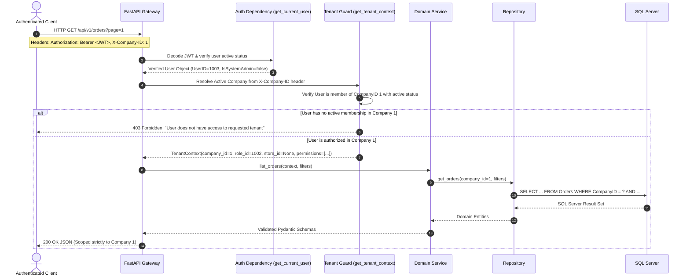

# System Architecture: Multi-Tenant Sales Management & Analytics System

## 1. Executive Summary & Architecture Mission

The **Enterprise Multi-Tenant Sales Management & Analytics System** is a reconstructed, full-stack enterprise web application designed to support multiple independent business organizations (companies/tenants) and their constituent retail or regional stores on a unified, high-performance infrastructure.

The architecture combines:
- **Presentation Layer**: React (TypeScript), Vite, Bootstrap 5, React Router, and Plotly.js for interactive analytics.
- **Application & Service Layer**: Python FastAPI RESTful API utilizing dependency injection, Pydantic v2 validation, and Pandas for analytical aggregations.
- **Data Access Layer**: Repository pattern with raw parameterized SQL via `pyodbc` for maximum performance, transparency, and explicit SQL Server control.
- **Persistence Layer**: Microsoft SQL Server (`SalesManagementDB`) with a multi-tenant relational schema, composite foreign keys for store-company integrity, indexing, and transactional boundaries.

---

## 2. High-Level System Architecture Diagram

```mermaid
flowchart TB
    subgraph ClientTier["Client / Presentation Tier (Browser)"]
        ReactApp["React 19 + TypeScript SPA (Vite)"]
        subgraph UIComponents["UI Modules"]
            AuthUI["🔐 Auth & Tenant Selector"]
            DashUI["📊 Executive Dashboard"]
            OpsUI["🛒 Orders & Customers & Products"]
            AdminUI["🏢 Companies & Stores & Users"]
            AnalyticsUI["📈 Multi-Dimensional Analytics (Plotly.js)"]
        end
        ReactApp --> AuthUI & DashUI & OpsUI & AdminUI & AnalyticsUI
    end

    subgraph APITier["Backend API Tier (FastAPI / Python)"]
        Gateway["FastAPI Application (/api/v1)"]
        subgraph Middlewares["Security & Context Pipeline"]
            CORSMW["CORS Middleware"]
            AuthDep["JWT / Session Dependency"]
            TenantContext["Active Tenant Resolution & Guard"]
            RBACDep["Permission & Role Guard (RBAC)"]
        end
        
        Gateway --> Middlewares
        
        subgraph Routers["API Routers"]
            R_Auth["/auth"]
            R_Comp["/companies"]
            R_Stores["/stores"]
            R_Users["/users"]
            R_Cust["/customers"]
            R_Prod["/products"]
            R_Orders["/orders"]
            R_Analytics["/analytics & /dashboard"]
            R_Import["/imports"]
        end
        
        Middlewares --> Routers
    end

    subgraph ServiceTier["Service & Business Logic Tier"]
        CompanyService["Company & Store Service"]
        UserService["User & RBAC Service"]
        CustomerService["Customer Service"]
        ProductService["Product Catalog Service"]
        OrderService["Transactional Order Service"]
        AnalyticsService["Analytics & Pandas Engine"]
        ETLService["CSV Validation & Import Pipeline"]
    end

    Routers --> ServiceTier

    subgraph DAL["Repository & Data Access Tier (pyodbc)"]
        UnitOfWork["Database Transaction / Context Manager"]
        CompanyRepo["Company & Store Repository"]
        UserRepo["User & Membership Repository"]
        CustomerRepo["Customer Repository"]
        ProductRepo["Product Repository"]
        OrderRepo["Order & Detail Repository"]
        AnalyticsRepo["Analytical Query Repository"]
    end

    ServiceTier --> DAL

    subgraph DBTier["Persistence Tier (Microsoft SQL Server)"]
        SQLServer[("SalesManagementDB")]
        subgraph MultiTenantSchema["Multi-Tenant Schema"]
            T_Comp["Companies (Tenants)"]
            T_Store["Stores"]
            T_Users["Users & UserCompanies"]
            T_Roles["Roles, Permissions, RolePermissions"]
            T_Cust["Customers (CompanyID FK)"]
            T_Prod["Products (CompanyID FK)"]
            T_Ord["Orders (CompanyID FK, StoreID FK)"]
            T_OrdDet["OrderDetails (OrderID FK, ProductID FK)"]
            T_Audit["AuditLogs"]
            T_Staging["RawSalesData (Staging)"]
        end
        SQLServer --- MultiTenantSchema
    end

    DAL <-->|ODBC Driver 17 / Parameterized SQL| SQLServer
```

---

## 3. Multi-Tenancy & Data Isolation Model

### 3.1 Tenancy Strategy: Shared Database, Shared Process, Row-Level Tenant Scoping

We utilize a **Shared Database with Discriminator Column (`CompanyID`)** and **Composite Foreign Key Integrity** model:
1. **Tenant Identifier**: Every core business table (`Customers`, `Products`, `Orders`, `Stores`, `UserCompanies`) possesses an indexed `CompanyID` column.
2. **Store Scoping**: Stores belong strictly to a single Company via `Stores (StoreID, CompanyID)`.
3. **Composite Foreign Key Constraints**:
   - `Orders` table enforces `FOREIGN KEY (StoreID, CompanyID) REFERENCES Stores (StoreID, CompanyID)`.
   - This physically prevents an order in Company A from referencing a store in Company B at the database engine level.
4. **Line Item Containment**: `OrderDetails` references `Orders(OrderID)` and `Products(ProductID)`. Service-layer validation asserts that `Products.CompanyID == Orders.CompanyID` prior to insertion.

### 3.2 Tenant Context Resolution Lifecycle

---

## 4. Role-Based Access Control (RBAC) Architecture

### 4.1 System Roles vs. Tenant Roles

1. **System Administrator (`IsSystemAdmin = 1`)**:
   - Cross-tenant superuser.
   - Authorized to manage companies, global system settings, and inspect all tenant boundaries.
2. **Company Administrator (`RoleID = 1002`)**:
   - Administrative master of their specific company.
   - Can manage company profile, create stores, manage company users, assign tenant roles, and view all operational data.
3. **Manager / Store Manager (`RoleID = 2`)**:
   - Can manage orders, products, and customers within their assigned store (or all company stores if unassigned).
4. **Sales Staff / Employee (`RoleID = 1004 / 3`)**:
   - Operational role: can create and view orders, lookup products, and manage customers.
5. **Read-Only Analyst**:
   - Read-only access to dashboards, sales analytics, and operational reports.

### 4.2 Permission Mapping Matrix

| Permission Code | Description | Platform Admin | Company Admin | Store Manager | Sales Staff | Read-Only Analyst |
| :--- | :--- | :---: | :---: | :---: | :---: | :---: |
| `MANAGE_COMPANIES` | Create/edit companies | ✅ | ❌ | ❌ | ❌ | ❌ |
| `MANAGE_STORES` | Create/edit company stores | ✅ | ✅ | ❌ | ❌ | ❌ |
| `MANAGE_USERS` | Provision & assign users | ✅ | ✅ | ❌ | ❌ | ❌ |
| `MANAGE_ROLES` | Configure role permissions | ✅ | ✅ | ❌ | ❌ | ❌ |
| `VIEW_PRODUCTS` | Read product catalog | ✅ | ✅ | ✅ | ✅ | ✅ |
| `CREATE_PRODUCT` | Create new catalog items | ✅ | ✅ | ✅ | ❌ | ❌ |
| `UPDATE_PRODUCT` | Modify existing products | ✅ | ✅ | ✅ | ❌ | ❌ |
| `DELETE_PRODUCT` | Deactivate/remove products | ✅ | ✅ | ❌ | ❌ | ❌ |
| `VIEW_CUSTOMERS` | View customer directory | ✅ | ✅ | ✅ | ✅ | ✅ |
| `CREATE_CUSTOMER`| Add new customer | ✅ | ✅ | ✅ | ✅ | ❌ |
| `UPDATE_CUSTOMER`| Modify customer info | ✅ | ✅ | ✅ | ✅ | ❌ |
| `DELETE_CUSTOMER`| Deactivate customer | ✅ | ✅ | ❌ | ❌ | ❌ |
| `VIEW_ORDERS` | View order history | ✅ | ✅ | ✅ | ✅ | ✅ |
| `CREATE_ORDER` | Create new sales order | ✅ | ✅ | ✅ | ✅ | ❌ |
| `UPDATE_ORDER` | Update order details | ✅ | ✅ | ✅ | ❌ | ❌ |
| `DELETE_ORDER` | Cancel / delete order | ✅ | ✅ | ❌ | ❌ | ❌ |
| `VIEW_REPORTS` | View dashboards & analytics | ✅ | ✅ | ✅ | ✅ | ✅ |

---

## 5. Backend Architecture (FastAPI & Python)

The backend follows an explicit **Clean / Onion Layered Architecture**:
1. **API Router Layer (`app/api/routes/`)**:
   - Defines HTTP endpoints, routes, status codes, and OpenAPI documentation tags.
   - Injects security and tenant dependencies.
   - Validates incoming payloads via Pydantic schemas.
2. **Service Layer (`app/services/`)**:
   - Implements business logic, transaction coordination, cross-entity validation, and financial calculations.
3. **Repository Layer (`app/repositories/`)**:
   - Interacts with SQL Server using `pyodbc`.
   - Executes parameterized SQL statements with safe parameter binding (`?`).
   - Converts raw database tuples into structured domain dictionaries and DataFrames.
4. **Database Connection & Transaction Manager (`app/db/`)**:
   - Manages connection lifecycle and connection pooling.
   - Provides context managers for transactional commits and automatic rollback on unhandled exceptions.

---

## 6. Frontend Architecture (React, TypeScript, Bootstrap 5)

### 6.1 Principles & Technology Stack
- **Framework**: React 19 with TypeScript for strong static typing and contract adherence with backend schemas.
- **Styling**: Bootstrap 5 + custom CSS variables for clean SaaS typography, spacing, and contrast.
- **Routing**: React Router v6 with `ProtectedRoute`, `TenantRequiredRoute`, and `AdminRoute` guards.
- **State Management**:
  - `AuthContext`: Manages user credentials, authentication token, permitted companies/stores, and current active tenant selection.
  - Local state for filters, pagination, and modals.
- **Data Visualizations**: Plotly.js charts encapsulated into reusable React chart components (`SalesTrendChart`, `CategoryBarChart`, `RegionalPieChart`).

### 6.2 Application Navigation Structure
- **Public**:
  - `/login`: Secure authentication form with show/hide password, error banners, and loading states.
- **Tenant Context Selection**:
  - `/select-tenant`: Company selection modal/screen for users with memberships in multiple companies.
- **Authenticated App Shell**:
  - `/dashboard`: KPI cards, sales distributions, top rankings.
  - `/orders`: Filterable, paginated orders directory with line-item drilldown modal and new order creation wizard.
  - `/customers`: Customer master with lifetime purchase metrics and order history.
  - `/products`: Product catalog with category filters and sales drilldown.
  - `/analytics`: Multi-dimensional slicer (Category, Segment, Region, Date Range) with monthly trend analysis.
  - `/stores`: Store administration within active company.
  - `/users`: User and membership management within active company.
  - `/companies`: Platform-wide tenant management (Restricted to Platform Administrators).
  - `/imports`: CSV validation and ETL ingestion console.

---

## 7. Metrics & Financial Calculation Formulas

To maintain strict accounting consistency across the SQL Server database, Pandas aggregation layer, and Plotly charts:

1. **Line Item Sales**:
   $$\text{Sales} = \text{Quantity} \times \text{UnitPrice} \times (1 - \text{Discount})$$
2. **Line Item Profit**:
   $$\text{Profit} = \text{Sales} - (\text{Quantity} \times \text{UnitCost})$$
3. **Profit Margin (%)**:
   $$\text{Profit Margin} = \begin{cases} \left(\frac{\text{Total Profit}}{\text{Total Sales}}\right) \times 100, & \text{if Total Sales} > 0 \\ 0, & \text{otherwise} \end{cases}$$
4. **Order Sales Total**:
   $$\text{Order Total} = \sum_{\text{lines}} \text{Line Sales}$$
   *Rule: Order-level queries must aggregate across `OrderDetails` to prevent double-counting when joining orders with customer metadata.*
