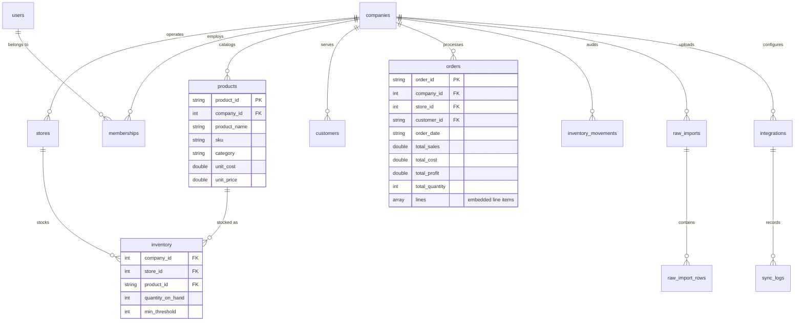

# Database Design Specification: SIMS MongoDB Document Architecture

## 1. Overview & Architecture Strategy

SIMS utilizes a **MongoDB** document-based data layer architected specifically for multi-tenant retail operations, high-throughput CSV data ingestion, and multi-dimensional analytical aggregation.

### Key Architectural Decisions

1. **Shared-Database, Tagged Multi-Tenancy**: All tenants share a single database, with every business document carrying an indexed `company_id`.
2. **Denormalized Line Items**: Orders embed their itemized lines as a subdocument array (`lines[]`), ensuring atomic order creation without multi-table relational joins.
3. **Compound Unique Indexes**: Uniqueness is enforced at the tenant boundary (e.g., `(company_id, product_id)`, `(company_id, order_id)`).
4. **Time-To-Live (TTL) Indexes**: Used for automatic maintenance of ephemeral records (revoked JWT tokens and rate-limiting login attempts).
5. **Driver & Mocking Layer**: Official `pymongo` driver with automatic `mongomock` in-memory fallback for test isolation.

---

## 2. Entity-Relationship & Collection Model



---

## 3. Collections & Index Specifications

### 3.1 Organization & Security

#### `companies`
- **Purpose**: Multi-tenant registry.
- **Indexes**:
  - `{company_id: 1}` (unique)
  - `{code: 1}`

#### `stores`
- **Purpose**: Physical or regional retail outlets.
- **Indexes**:
  - `{company_id: 1, store_id: 1}` (unique)
  - `{store_id: 1}`

#### `users`
- **Purpose**: Authentication credentials and platform administration flag.
- **Indexes**:
  - `{user_id: 1}` (unique)
  - `{username: 1}` (unique)
  - `{email: 1}` (unique)

#### `memberships`
- **Purpose**: User-Company tenant assignments, store bindings, roles, and granular permissions.
- **Indexes**:
  - `{user_id: 1, company_id: 1}` (unique)
  - `{company_id: 1, store_id: 1}`

#### `revoked_tokens`
- **Purpose**: JWT blacklist for immediate token revocation upon logout.
- **Indexes**:
  - `{token: 1}` (unique)
  - `{expires_at: 1}` (TTL index, expires after `expires_at`)

#### `login_attempts`
- **Purpose**: IP and identifier tracking for rate limiting (5 attempts per 15 minutes).
- **Indexes**:
  - `{identifier: 1, ip_address: 1}`
  - `{timestamp: 1}` (TTL index: 900 seconds)

---

### 3.2 Product Catalog & Inventory

#### `products`
- **Fields**: `company_id`, `product_id`, `product_name`, `sku`, `category`, `sub_category`, `unit_cost`, `unit_price`, `is_active`.
- **Indexes**:
  - `{company_id: 1, product_id: 1}` (unique)
  - `{company_id: 1, sku: 1}`
  - `{company_id: 1, category: 1}`

#### `inventory`
- **Fields**: `company_id`, `store_id`, `product_id`, `quantity_on_hand`, `min_threshold`.
- **Indexes**:
  - `{company_id: 1, store_id: 1, product_id: 1}` (unique)
  - `{company_id: 1, store_id: 1}`

#### `inventory_movements`
- **Fields**: `movement_id`, `company_id`, `from_store_id`, `to_store_id`, `product_id`, `quantity`, `movement_type` (RECEIPT/TRANSFER/ADJUSTMENT), `timestamp`, `performed_by`.
- **Indexes**:
  - `{movement_id: 1}` (unique)
  - `{company_id: 1, timestamp: -1}`
  - `{company_id: 1, product_id: 1}`

---

### 3.3 Sales & Customers

#### `customers`
- **Fields**: `customer_id`, `company_id`, `customer_name`, `segment`, `email`, `phone`, `city`, `state`, `postal_code`, `region`.
- **Indexes**:
  - `{company_id: 1, customer_id: 1}` (unique)
  - `{company_id: 1, customer_name: 1}`

#### `orders`
- **Fields**: `order_id`, `company_id`, `store_id`, `customer_id`, `order_date`, `ship_date`, `ship_mode`, `total_sales`, `total_cost`, `total_profit`, `total_quantity`, `lines[]`.
- **Embedded Lines Array**: Each element contains `line_id`, `product_id`, `product_name`, `category`, `quantity`, `unit_price`, `unit_cost`, `sales`, `discount`, `profit`.
- **Indexes**:
  - `{company_id: 1, order_id: 1}` (unique)
  - `{company_id: 1, store_id: 1, order_date: -1}`
  - `{company_id: 1, customer_id: 1}`

---

### 3.4 Ingestion & Integrations

#### `raw_imports` & `raw_import_rows`
- **Purpose**: Path A exploratory ingestion preserving all source columns without data loss.
- **Indexes**:
  - `raw_imports`: `{company_id: 1, import_id: 1}` (unique)
  - `raw_import_rows`: `{company_id: 1, import_id: 1, row_index: 1}` (unique)

#### `structured_imports`
- **Purpose**: Path B ETL import audit trail with counts of created, updated, and failed records.
- **Indexes**:
  - `{company_id: 1, import_id: 1}` (unique)
  - `{company_id: 1, created_at: -1}`

#### `integrations` & `sync_logs`
- **Purpose**: External connector configuration and incremental sync execution history.
- **Indexes**:
  - `integrations`: `{company_id: 1, integration_id: 1}` (unique)
  - `sync_logs`: `{log_id: 1}` (unique), `{company_id: 1, integration_id: 1, started_at: -1}`

---

## 4. Analytical Pipeline Patterns

### Consolidated Dashboard Metrics
```json
[
  {"$match": {"company_id": 1, "store_id": 2}},
  {"$group": {
    "_id": null,
    "total_sales": {"$sum": "$total_sales"},
    "total_profit": {"$sum": "$total_profit"},
    "total_orders": {"$sum": 1},
    "total_units": {"$sum": "$total_quantity"}
  }}
]
```

### Category-Level Sales Aggregation
```json
[
  {"$match": {"company_id": 1}},
  {"$unwind": "$lines"},
  {"$group": {
    "_id": "$lines.category",
    "total_sales": {"$sum": "$lines.sales"},
    "total_profit": {"$sum": "$lines.profit"}
  }},
  {"$sort": {"total_sales": -1}}
]
```
