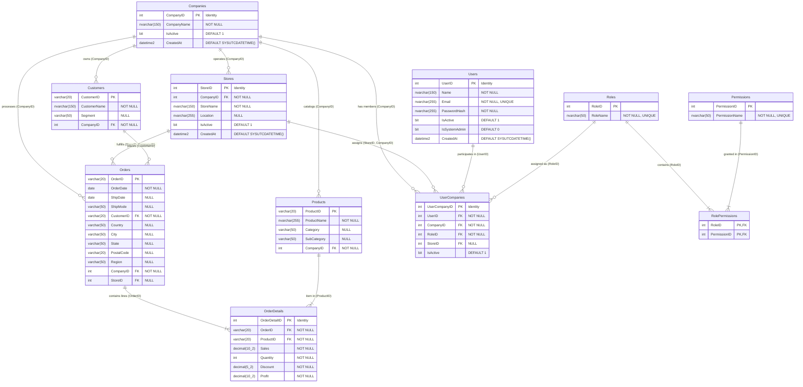

# Database Design Proposal: Multi-Tenant Sales Management & Analytics System

## 1. Overview & Objectives

The database architecture is built for **Microsoft SQL Server** (`SalesManagementDB`). It provides:
1. **Multi-Tenancy**: Data isolation across distinct commercial organizations via `CompanyID`.
2. **Hierarchical Scoping**: Companies own one or more physical or regional `Stores`.
3. **Referential Integrity**: Strict primary and foreign key constraints, including composite foreign keys preventing cross-tenant leakage.
4. **Financial Consistency**: Precise decimal handling (`DECIMAL(10,2)` for currency and `DECIMAL(5,2)` for discounts) avoiding floating-point rounding errors.
5. **Auditing & Timestamps**: UTC creation/update timestamps and structured action logs.

---

## 2. Entity-Relationship Diagram (ERD)

---

## 3. Detailed Table Specifications

### 3.1 Tenancy & Organizations

#### `Companies`
Primary tenant entity representing an enterprise organization.
| Column | Type | Constraints | Description |
| :--- | :--- | :--- | :--- |
| `CompanyID` | `INT IDENTITY(1,1)` | `PRIMARY KEY` | Unique organization identifier |
| `CompanyName` | `NVARCHAR(150)` | `NOT NULL` | Registered company/tenant name |
| `IsActive` | `BIT` | `NOT NULL DEFAULT 1`| Soft-disable flag |
| `CreatedAt` | `DATETIME2` | `NOT NULL DEFAULT SYSUTCDATETIME()` | UTC onboarding timestamp |

#### `Stores`
Physical or virtual retail outlet owned by a Company.
| Column | Type | Constraints | Description |
| :--- | :--- | :--- | :--- |
| `StoreID` | `INT IDENTITY(1,1)` | `PRIMARY KEY` | Store identifier |
| `CompanyID` | `INT` | `NOT NULL, FK -> Companies(CompanyID)` | Owning tenant |
| `StoreName` | `NVARCHAR(150)` | `NOT NULL` | Branch/Store name |
| `Location` | `NVARCHAR(255)` | `NULL` | Physical address / City / Region |
| `IsActive` | `BIT` | `NOT NULL DEFAULT 1` | Active operational status |
| `CreatedAt` | `DATETIME2` | `NOT NULL DEFAULT SYSUTCDATETIME()` | Creation timestamp |

*Composite Unique Constraint*: `(StoreID, CompanyID)` is uniquely indexed to enable composite foreign keys from `Orders` and `UserCompanies`.

---

### 3.2 Identity, RBAC & Memberships

#### `Users`
Application user credentials and global attributes.
| Column | Type | Constraints | Description |
| :--- | :--- | :--- | :--- |
| `UserID` | `INT IDENTITY(1,1)` | `PRIMARY KEY` | Unique user identity |
| `Name` | `NVARCHAR(150)` | `NOT NULL` | Full display name |
| `Email` | `NVARCHAR(255)` | `NOT NULL, UNIQUE` | Normalized login email |
| `PasswordHash` | `NVARCHAR(255)` | `NOT NULL` | Salted SHA-256 / PBKDF2 hash string |
| `IsActive` | `BIT` | `NOT NULL DEFAULT 1` | User active status |
| `IsSystemAdmin` | `BIT` | `NOT NULL DEFAULT 0` | Superuser platform privilege |
| `CreatedAt` | `DATETIME2` | `NOT NULL DEFAULT SYSUTCDATETIME()` | Account creation time |

#### `UserCompanies`
User-to-Tenant membership relationship with role assignment and optional store restriction.
| Column | Type | Constraints | Description |
| :--- | :--- | :--- | :--- |
| `UserCompanyID` | `INT IDENTITY(1,1)` | `PRIMARY KEY` | Membership identity |
| `UserID` | `INT` | `NOT NULL, FK -> Users(UserID)` | User reference |
| `CompanyID` | `INT` | `NOT NULL, FK -> Companies(CompanyID)` | Tenant reference |
| `RoleID` | `INT` | `NOT NULL, FK -> Roles(RoleID)` | Tenant-level role |
| `StoreID` | `INT` | `NULL, FK -> Stores(StoreID)` | Optional store-level scoping |
| `IsActive` | `BIT` | `NOT NULL DEFAULT 1` | Membership status |

#### `Roles`, `Permissions`, `RolePermissions`
- Standard RBAC schema mapping permissions (`VIEW_ORDERS`, `CREATE_ORDER`, `VIEW_REPORTS`, etc.) to roles (`Admin`, `Company Admin`, `Manager`, `Employee`, etc.).

---

### 3.3 Sales Master & Transactional Entities

#### `Customers`
| Column | Type | Constraints | Description |
| :--- | :--- | :--- | :--- |
| `CustomerID` | `VARCHAR(20)` | `PRIMARY KEY` | Customer business code |
| `CustomerName` | `NVARCHAR(150)` | `NOT NULL` | Full name of customer |
| `Segment` | `VARCHAR(50)` | `NULL` | Market segment (Consumer, Corporate, Home Office) |
| `CompanyID` | `INT` | `NOT NULL, FK -> Companies(CompanyID)` | Owning tenant |

#### `Products`
| Column | Type | Constraints | Description |
| :--- | :--- | :--- | :--- |
| `ProductID` | `VARCHAR(20)` | `PRIMARY KEY` | SKU / Product identifier |
| `ProductName` | `NVARCHAR(255)` | `NOT NULL` | Item description |
| `Category` | `VARCHAR(50)` | `NULL` | High-level category (Technology, Furniture, etc.) |
| `SubCategory` | `VARCHAR(50)` | `NULL` | Granular grouping (Phones, Chairs, etc.) |
| `CompanyID` | `INT` | `NOT NULL, FK -> Companies(CompanyID)` | Owning tenant |

#### `Orders`
| Column | Type | Constraints | Description |
| :--- | :--- | :--- | :--- |
| `OrderID` | `VARCHAR(20)` | `PRIMARY KEY` | Unique transaction order code |
| `OrderDate` | `DATE` | `NOT NULL` | Transaction date |
| `ShipDate` | `DATE` | `NULL` | Dispatch date |
| `ShipMode` | `VARCHAR(50)` | `NULL` | Delivery method |
| `CustomerID` | `VARCHAR(20)` | `NOT NULL, FK -> Customers(CustomerID)` | Buyer |
| `Country` | `VARCHAR(50)` | `NULL` | Geographic country |
| `City` | `VARCHAR(50)` | `NULL` | Delivery city |
| `State` | `VARCHAR(50)` | `NULL` | Delivery state/province |
| `PostalCode` | `VARCHAR(20)` | `NULL` | Postal code |
| `Region` | `VARCHAR(50)` | `NULL` | Geographic region (West, East, Central, South) |
| `CompanyID` | `INT` | `NOT NULL, FK -> Companies(CompanyID)` | Owning tenant |
| `StoreID` | `INT` | `NULL` | Associated branch/store |

*Integrity Constraints*:
- `FOREIGN KEY (CompanyID) REFERENCES Companies(CompanyID)`
- `FOREIGN KEY (StoreID, CompanyID) REFERENCES Stores(StoreID, CompanyID)`

#### `OrderDetails`
Line items associated with orders.
| Column | Type | Constraints | Description |
| :--- | :--- | :--- | :--- |
| `OrderDetailID` | `INT IDENTITY(1,1)` | `PRIMARY KEY` | Line item unique ID |
| `OrderID` | `VARCHAR(20)` | `NOT NULL, FK -> Orders(OrderID)` | Parent order |
| `ProductID` | `VARCHAR(20)` | `NOT NULL, FK -> Products(ProductID)` | Item SKU |
| `Sales` | `DECIMAL(10,2)` | `NOT NULL` | Net line transaction revenue |
| `Quantity` | `INT` | `NOT NULL` | Quantity purchased |
| `Discount` | `DECIMAL(5,2)` | `NOT NULL` | Discount applied (0.00 to 1.00) |
| `Profit` | `DECIMAL(10,2)` | `NOT NULL` | Net profit generated on line |

---

### 3.4 Auditing & Staging

#### `AuditLogs`
Tracks security-sensitive events, tenant membership changes, and administrative actions.
| Column | Type | Constraints | Description |
| :--- | :--- | :--- | :--- |
| `AuditID` | `INT IDENTITY(1,1)` | `PRIMARY KEY` | Log identifier |
| `UserID` | `INT` | `NULL, FK -> Users(UserID)` | Actor |
| `CompanyID` | `INT` | `NULL, FK -> Companies(CompanyID)` | Scoped tenant |
| `Action` | `VARCHAR(50)` | `NOT NULL` | Event tag (`LOGIN`, `CREATE_USER`, `DELETE_ORDER`) |
| `EntityName` | `VARCHAR(50)` | `NULL` | Target entity (`Orders`, `Users`) |
| `EntityID` | `VARCHAR(50)` | `NULL` | Record key |
| `Details` | `NVARCHAR(MAX)` | `NULL` | JSON or text change context |
| `IPAddress` | `VARCHAR(45)` | `NULL` | Client IP |
| `CreatedAt` | `DATETIME2` | `NOT NULL DEFAULT SYSUTCDATETIME()` | UTC event timestamp |

#### `RawSalesData` (Staging Table)
Denormalized staging buffer for Superstore CSV ETL pipeline validation before atomic insertion.

---

## 4. Indexing Strategy

To guarantee rapid query response times under high concurrency and millions of order rows:

1. **Tenant Filtering Indexes**:
   - `IX_Orders_CompanyID_OrderDate ON Orders(CompanyID, OrderDate DESC) INCLUDE (CustomerID, StoreID, Region)`
   - `IX_Customers_CompanyID ON Customers(CompanyID) INCLUDE (CustomerName, Segment)`
   - `IX_Products_CompanyID ON Products(CompanyID) INCLUDE (ProductName, Category, SubCategory)`
2. **Line Item Aggregation Indexes**:
   - `IX_OrderDetails_OrderID ON OrderDetails(OrderID) INCLUDE (ProductID, Sales, Quantity, Profit)`
   - `IX_OrderDetails_ProductID ON OrderDetails(ProductID) INCLUDE (Sales, Profit)`
3. **Composite Integrity Indexes**:
   - `UQ_Stores_StoreID_CompanyID ON Stores(StoreID, CompanyID)`
   - `IX_Orders_StoreID_CompanyID ON Orders(StoreID, CompanyID)`
4. **Authentication Indexes**:
   - `UQ_Users_Email ON Users(Email)`
   - `IX_UserCompanies_User_Company ON UserCompanies(UserID, CompanyID) INCLUDE (RoleID, StoreID, IsActive)`
